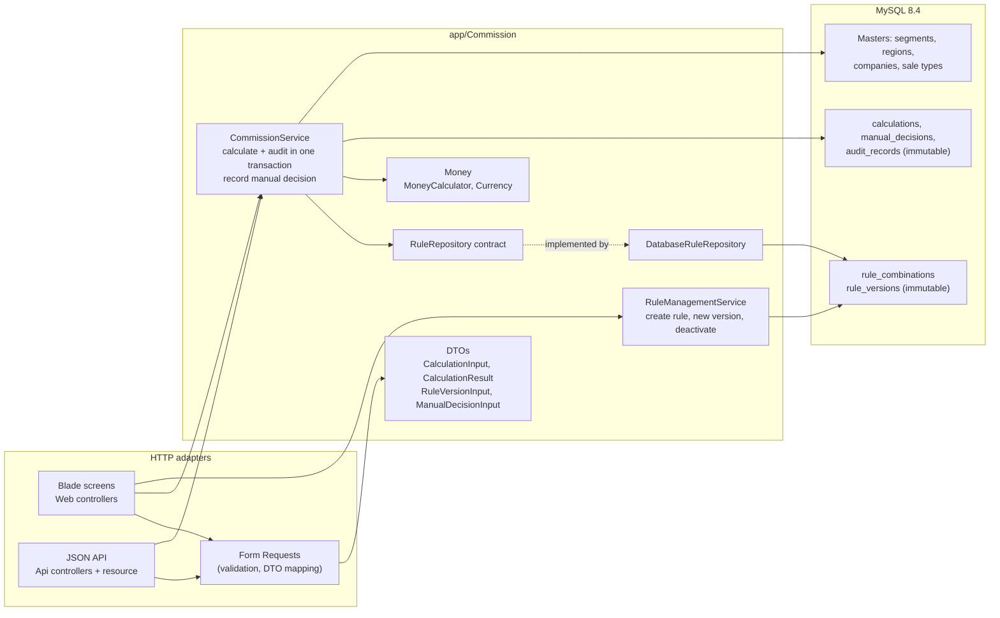

# Commission and referral rules engine (local demo)

> ### ▶ [Start here: run the demo in your browser](QUICKSTART.md)
>
> Step-by-step Windows guide for reviewers with no Laravel or Docker experience.

> **Illustrative data only.** Every percentage, payment direction, company label and amount in this repository is invented sample data. None of it represents FG's actual commercial terms.
>
> **Not production-ready.** This is a locally run demo for review. The API and screens have no authentication, and approver names are self-declared. See [Limitations and production follow-ups](#limitations-and-production-follow-ups).

## Contents

- [Quick start guide (QUICKSTART.md)](QUICKSTART.md)
- [Purpose and scope](#purpose-and-scope)
- [Prerequisites and versions](#prerequisites-and-versions)
- [Start the application](#start-the-application)
- [Run the tests](#run-the-tests)
- [Stop, restart and reset](#stop-restart-and-reset)
- [Using the screens](#using-the-screens)
- [Sample inputs and results](#sample-inputs-and-results)
- [Payment direction](#payment-direction)
- [API and PowerShell examples](#api-and-powershell-examples)
- [Architecture](#architecture)
- [Data model, migrations and seeding](#data-model-migrations-and-seeding)
- [Money and rounding](#money-and-rounding)
- [Manual decisions](#manual-decisions)
- [Business assumptions](#business-assumptions)
- [Design decisions and trade-offs](#design-decisions-and-trade-offs)
- [Integration boundary with the Part A design](#integration-boundary-with-the-part-a-design)
- [Test coverage](#test-coverage)
- [Limitations and production follow-ups](#limitations-and-production-follow-ups)
- [Project layout](#project-layout)

## Purpose and scope

This is a small rules engine. It calculates the commission or referral payment between FG and a partner company. The payable percentage depends on four inputs:

| Dimension | Values |
|---|---|
| Product segment | Building Envelope, Protection, Specialty |
| Sale destination region | GCC, Europe, India, North America, Rest of World |
| Lead-generating company | FG, Partner |
| Sale type | Glass only, Complete system |

Each calculation produces exactly one of three outcomes:

| Outcome | Meaning | Rate, amount, payer, payee |
|---|---|---|
| **Fixed rule applied** | An active fixed rule matched. Explicit 0% is a valid fixed rule. | All set |
| **Decided case by case — manual approval required** | An active rule matched, but it is configured as case by case. | All null |
| **No matching rule — manual review required** | No active rule exists for the exact combination. | All null |

Missing configuration is never turned into 0%. Rules are stored in the database and managed on the Rules screen; none are hardcoded. Every calculation is stored in the same transaction as an immutable audit record. The record explains which rule applied and why, with snapshots of the inputs, the rule and the result.

**In scope:**

- one payable outcome per calculation;
- rule management with immutable versions;
- calculation history with audit detail;
- one manual decision for each pending calculation;
- a small JSON API.

**Out of scope:**

- separate commission and referral formulas;
- foreign-exchange (FX) conversion, tax on commission, settlement and payments;
- authentication;
- any dependency on order or production system tables.

External order and plant references are optional, free-text context fields.

## Prerequisites and versions

Only **Docker Desktop** (Linux containers, with Compose v2) is needed. PHP, Composer, MySQL and Node are not needed on the host; everything runs inside containers. Port 8080 must be free on `127.0.0.1`, or you can change `APP_PORT` (see `.env.example` and [QUICKSTART.md](QUICKSTART.md#port-8080-is-already-in-use)).

| Component | Version | Notes |
|---|---|---|
| PHP | 8.4 (`php:8.4-apache-bookworm`) | Laravel 13 requires PHP 8.3 or newer. The 64-bit integer arithmetic is covered by the tests. |
| Laravel | 13.35 | Locked in `composer.lock` |
| MySQL | 8.4 LTS (`mysql:8.4`) | CHECK constraints and composite foreign keys are enforced |
| PHPUnit | 12.5 | Runs inside the app container |
| Composer | 2.10 | Used only during the image build |

**Verified environment:** Windows 11 Home, Windows PowerShell 5.1, Docker Desktop 4.43.2, Docker Engine 28.3.2, Docker Compose v2.38.2-desktop.1. The demo has not been tested on macOS or Linux. Docker should behave the same there, but this is not verified.

## Start the application

New to Docker? Follow [QUICKSTART.md](QUICKSTART.md). It covers installing Docker Desktop, downloading the project and troubleshooting.

From the project root (the folder containing `compose.yaml`), in PowerShell:

```powershell
docker compose up --build -d
docker compose ps
```

Wait until `app` and `db` both show `(healthy)`, then open **http://127.0.0.1:8080**. To follow the logs instead of running in the background, leave out `-d`. The app is ready when the log shows Apache "resuming normal operations".

No `.env` file, Composer install, migration or seeding command is needed: `compose.yaml` contains non-sensitive demo defaults, and the container prepares the database itself.

**What happens on the first start:**

1. MySQL initialises the named volume `mysql-data`. It creates the demo database `commission`, plus a separate `commission_test` database and user for the automated tests.
2. The app container waits for the MySQL health check.
3. The app generates a random application key and stores it in the named volume `app-data`, so later restarts reuse it.
4. `php artisan commission:setup` waits for the database and runs `migrate --force`. It seeds the master data and the four illustrative rules **only if the database has never been seeded**.
5. Apache starts as the unprivileged `www-data` user. The port is published only on `127.0.0.1:8080`, and MySQL's port is not published.

## Run the tests

With the stack running:

```powershell
docker compose exec app php artisan test
```

The tests use `RefreshDatabase`, which rebuilds the database it is connected to. Three safeguards keep it away from the demo data:

- **Separate test database.** `phpunit.xml` forces the connection to the MySQL database `commission_test`, with its own user and password.
- **Restricted test user.** The MySQL init script grants the test user privileges on `commission_test` only. It has no access to the demo database `commission`.
- **Connection guard.** `tests/TestCase.php` refuses to boot unless the environment is `testing`, the database is `commission_test`, and configuration is not cached.

Together these stop the tests from reaching the demo database through normal configuration mistakes. They do not protect against someone deliberately changing the guard or granting the test user extra privileges.

**Last full run** (reported on 8 October 2026, after the rule update work): **140 tests, 784 assertions, all passing**. See [Test coverage](#test-coverage) for what was re-checked during the documentation update.

## Stop, restart and reset

| Action | Command | Data |
|---|---|---|
| Stop | `docker compose down` | Kept (named volumes remain) |
| Restart | `docker compose up -d` | Existing data and app key reused; nothing re-seeded |
| Rebuild after code changes | `docker compose up --build -d` | Kept |
| **Destructive reset** | `docker compose down -v` then `docker compose up --build -d` | **Deletes all calculations, rule changes, decisions and the app key**, then re-creates and re-seeds |

## Using the screens

- **Calculate** (`/calculate`): choose the four dimensions, enter the eligible amount as a plain decimal (for example `1250.50`), choose a currency, and optionally add an external order reference and a plant reference.
  - The result shows the outcome, rate, amount, currency, payer, payee, the rule used and a plain-language explanation.
  - Pending outcomes show "Not set" instead of a rate or amount, with a link to record a manual decision.
- **Rules** (`/rules`): lists every combination with its active or inactive status and, while it is active, the current type, percentage, payer and payee. From here you can:
  - create a fixed or case-by-case rule for a combination that does not already have an active rule;
  - choose **Edit / Update** to change the type, percentage, payer, payee or note;
  - open **Versions** for the full history;
  - deactivate an active rule.

  **Edit / Update** uses the existing versioning flow. Saving inserts a new immutable version and makes that version active. Previous versions, calculations and audit snapshots stay as they were. Product segment, region, lead company and sale type define the combination and are shown read-only; a different combination is created with **New rule**. An inactive rule is not reactivated by that save button. Its page keeps the separate **Reactivate with a new version** action.

  With JavaScript, the update form checks fields as you leave them and submits only after those checks pass. Server-side field errors are shown beside the fields; a business or network error stays on the form until another save is attempted. Without JavaScript, the same form posts normally and the server validates it.
- **History** (`/calculations`): lists calculations, newest first. The detail page shows four sections:
  - the original inputs;
  - the original outcome;
  - the rule snapshot used at calculation time;
  - the manual decision, if any, and the audit trail.

  On pending calculations it also shows the manual decision form.

## Sample inputs and results

The seeder creates four illustrative rules:

| # | Segment / region / lead / sale type | Rule | Payment direction |
|---|---|---|---|
| 1 | Building Envelope / GCC / Partner / Glass only | 5% | FG pays Partner |
| 2 | Protection / Europe / FG / Complete system | 3% | Partner pays FG |
| 3 | Specialty / India / Partner / Complete system | Decided case by case | Not set |
| 4 | Building Envelope / India / FG / Glass only | Explicit 0% | FG pays Partner |

Results observed when running the demo:

| Input | Outcome | Rate | Amount | Payer → payee |
|---|---|---|---|---|
| Building Envelope / GCC / Partner / Glass only, AED 100,000.00 | Fixed | 5.00% | AED 5,000.00 | FG → Partner |
| Protection / Europe / FG / Complete system, EUR 2,500.50 | Fixed | 3.00% | EUR 75.02 (75.015 rounded half up) | Partner → FG |
| Specialty / India / Partner / Complete system, INR 750,000.00 | Case by case | Not set | Not set | Not set |
| Building Envelope / India / FG / Glass only, INR 5,000.00 | Fixed (explicit 0%) | 0.00% | INR 0.00 | FG → Partner |
| Specialty / GCC / FG / Glass only, USD 10.00 | No match | Not set | Not set | Not set |

Example explanation stored in the audit record:

> Rule #2 v1 matched exactly on segment Protection, sale destination Europe, lead generated by FG, sale type Complete system. It sets a fixed rate of 3.00%, paid by Partner to FG. 3.00% of EUR 2,500.50 = EUR 75.02, rounded once to the nearest minor unit (half up).

## Payment direction

Each fixed rule stores its payer and payee explicitly; the direction is never inferred. The four dimensions do not say which company closes and invoices the sale, and that determines who owes whom. For example:

- **Rule 1:** the Partner introduced a Building Envelope glass-only lead in the GCC and FG made the sale. FG pays the Partner 5% of the eligible amount.
- **Rule 2:** FG introduced a Protection complete-system lead in Europe and the Partner made the sale. The Partner pays FG 3%.
- **Rule 4:** the arrangement exists and names FG as payer, but the rate is 0%. The calculation is final, with a configured amount of 0.00. This is different from "no matching rule".

Payer and payee must be different companies. The form request, the input object and a database CHECK constraint all enforce this. A calculation records an amount that would be payable under the rule; it does not mean that a payment is due or has been made.

## API and PowerShell examples

The API is a demo convenience for the integration boundary. **It is unauthenticated and must not be exposed beyond localhost.** Production needs authentication, authorised access, rate limiting and audit of API clients.

| Method | Path | Purpose | Responses |
|---|---|---|---|
| `POST` | `/api/calculations` | Calculate and store one result | `201` result, `422` validation errors, `409` business-rule conflict |
| `GET` | `/api/calculations/{calculation_id}` | Audit detail: inputs, original outcome, rule snapshot, manual decision, audit trail | `200`, `404` |
| `GET` | `/api/masters` | Valid codes for segments, regions, companies, sale types and currencies | `200` |

**Calculate (Windows PowerShell 5.1 or PowerShell 7):**

```powershell
$body = @{
    segment                  = 'BUILDING_ENVELOPE'
    region                   = 'GCC'
    lead_company             = 'PARTNER'
    sale_type                = 'GLASS_ONLY'
    amount                   = '100000.00'   # always a string: decimals are never parsed as floats
    currency                 = 'AED'
    external_order_reference = 'DEMO-ORD-001' # optional
    plant_reference          = 'PLANT-DEMO'   # optional, context only
} | ConvertTo-Json

$result = Invoke-RestMethod -Method Post -Uri http://127.0.0.1:8080/api/calculations `
    -ContentType 'application/json' -Body $body
$result.data | Format-List outcome, rate_percent, commission_amount, currency, explanation
$result.data.payer; $result.data.payee
```

Response (abridged):

```json
{
  "data": {
    "calculation_id": "01a119a6-787a-731c-bdfb-eea473564aa3",
    "outcome": "fixed",
    "outcome_label": "Fixed rule applied",
    "pending_manual_decision": false,
    "eligible_amount": "100000.00",
    "currency": "AED",
    "rate_percent": "5.00",
    "rate_bps": 500,
    "commission_amount": "5000.00",
    "commission_minor": 500000,
    "payer": { "code": "FG", "name": "FG" },
    "payee": { "code": "PARTNER", "name": "Partner" },
    "rule": { "rule_id": 1, "version": 1, "reference": "Rule #1 v1", "kind": "fixed" },
    "explanation": "Rule #1 v1 matched exactly on ...",
    "policy_version": "rounding-v1"
  }
}
```

**Audit detail and master codes:**

```powershell
$id = $result.data.calculation_id
(Invoke-RestMethod "http://127.0.0.1:8080/api/calculations/$id").data | ConvertTo-Json -Depth 6
(Invoke-RestMethod http://127.0.0.1:8080/api/masters).data.regions
```

**Seeing a validation error body.** Windows PowerShell 5.1 often leaves `ErrorDetails` empty, so this example reads the response stream:

```powershell
$bad = @{ segment='PROTECTION'; region='EUROPE'; lead_company='FG'; sale_type='COMPLETE_SYSTEM'; amount='1.005'; currency='EUR' } | ConvertTo-Json
try {
    Invoke-RestMethod -Method Post -Uri http://127.0.0.1:8080/api/calculations -ContentType 'application/json' -Body $bad
} catch {
    $response = $_.Exception.Response
    "HTTP $([int]$response.StatusCode)"
    if ($_.ErrorDetails.Message) { $_.ErrorDetails.Message } else {
        $stream = $response.GetResponseStream(); $stream.Position = 0
        (New-Object System.IO.StreamReader($stream)).ReadToEnd()
    }
}
# HTTP 422
# {"message":"The eligible sale amount must have at most 2 decimal places.","errors":{"amount":[...]}}
```

Alternatively, run `curl.exe -s -X POST http://127.0.0.1:8080/api/calculations -H "Content-Type: application/json" -d '<json>'`, which prints the body for any status code.

## Architecture

Laravel modular structure: thin HTTP adapters, an application service that owns the transaction, a repository contract for rule lookup, an integer-only money component, and Eloquent models with database-level constraints.



**Calculation flow:**

1. A Form Request validates the input. Codes must exist and the currency must be supported. The amount must be a positive string with at most 2 decimals and no more than the maximum.
2. The request maps to a `CalculationInput` holding integer minor units.
3. `CommissionService` resolves the master records and asks the `RuleRepository` for the active version of the exact combination.
4. The service determines the outcome. It calculates an amount only for fixed rules.
5. In one database transaction it inserts the `Calculation` and its `AuditRecord`. The record holds the input, rule and result snapshots, the explanation and the policy version.
6. If the audit insert fails, the calculation is rolled back.
7. Controllers turn the `CalculationResult` into a screen or JSON.

Business-rule conflicts, such as a duplicate active rule or a second decision, raise `BusinessRuleViolation`. On the screens it appears as a form error; on the API it returns HTTP 409.

## Data model, migrations and seeding

Ten migrations create nine tables. The tenth migration adds the composite foreign key after both tables exist.

| Table | Purpose | Key constraints |
|---|---|---|
| `product_segments`, `regions`, `companies`, `sale_types` | Master data (code + display name) | Unique `code` |
| `rule_combinations` | One row per exact four-dimension combination | Unique (segment, region, lead company, sale type); foreign keys to the masters; nullable `active_rule_version_id` |
| `rule_versions` | Immutable rule content: kind, rate in basis points, payer, payee, note | Unique (combination, version); CHECK: fixed ⇒ rate 0–10000 and payer ≠ payee; case by case ⇒ rate, payer and payee all null |
| `calculations` | One immutable calculation | Amount > 0; currency in AED/USD/EUR/INR; CHECK that the outcome matches nullability (pending ⇒ null rate, amount, payer and payee) |
| `manual_decisions` | At most one decision per pending calculation | Unique `calculation_id`; CHECK: rate ≤ 10000 and payer ≠ payee |
| `audit_records` | Immutable audit trail | Unique (calculation, event); foreign keys to the calculation and decision |

**How the database enforces the rules:**

- **One active rule per combination.** The combination is unique, and it has a single `active_rule_version_id` pointer. A composite foreign key, `(active_rule_version_id, id)` → `rule_versions(id, rule_combination_id)`, ensures the pointer can only reference one of that combination's own versions.
- **Immutable history.** All foreign keys restrict deletion, so referenced versions, master records and calculations cannot be deleted. The `Immutable` model trait blocks updates and deletes of versions, calculations, decisions and audit records through Eloquent.
- **Master labels.** Labels can be renamed, but calculations keep the labels captured in their snapshots.

**Seeding.** `DatabaseSeeder` runs `MasterDataSeeder` (idempotent `firstOrCreate`) and `IllustrativeRuleSeeder` (skipped if any rule exists) in one transaction. The container's `commission:setup` command seeds only when the master tables are empty, so restarts never re-seed or overwrite rule changes. To reseed from scratch, use the destructive reset.

## Money and rounding

- Amounts are integer **minor units**: cents, fils or paise, with 2 decimals for AED, USD, EUR and INR. Rates are integer **basis points**: 1% = 100 bps, 100% = 10,000 bps.
- Amounts arrive as **decimal strings** and are parsed without floats. The parser rejects:
  - empty values;
  - zero or negative values;
  - signs, spaces, commas and exponents;
  - leading zeros;
  - more than 2 decimals;
  - amounts above **999,999,999,999.99**.

  JSON numbers are rejected too, because floats can't represent all decimals exactly.
- Rates are 0–100 with at most 2 decimals.
- Formula (policy `rounding-v1`): `commission_minor = (amount_minor × rate_bps + 5,000) div 10,000`, which rounds **once, half up**, to the nearest minor unit.
- At the maximum amount and 100%, the intermediate value is about 1.0 × 10^18, below PHP's 64-bit integer limit of about 9.22 × 10^18. A test checks this.
- Results are in the input currency, with no conversion.

## Manual decisions

A pending calculation (case by case or no match) can receive **one** final decision. The decision records:

- a rate (0–100%, 2 decimals);
- the payer and payee, which must differ;
- the approver name;
- a mandatory reason.

The amount is calculated from the original eligible amount with the same rounding policy.

- **The original stays untouched.** The decision is stored in its own row and appends a second audit record. The calculation row and the first audit record never change, and the detail screen shows "Original outcome" and "Manual decision" as separate sections.
- **Concurrency-safe.** The service locks the calculation row (`SELECT … FOR UPDATE`) and rejects a second decision. The unique `calculation_id` constraint is a final safeguard; a race that reaches it is reported as a business-rule conflict.
- **Fixed calculations** cannot receive a decision.
- **Approver identity is self-declared in this demo.** Nothing checks who the approver is. Production needs authenticated approvers, role permissions and an agreed approval workflow; the demo does not enforce any of these.

## Business assumptions

- **Region** is the sale destination: where the glass is delivered or the project is located.
- The **eligible amount** is the sale value after discounts and excluding taxes. Determining it is the caller's responsibility.
- Results are in the **input currency**. There is no FX conversion, no tax on commission, no settlement and no payment processing.
- **Payer and payee** are configured explicitly on each fixed rule (see [Payment direction](#payment-direction)).
- The **plant reference** and **external order reference** are context only. They are stored and shown, but never used for matching.
- A **calculation** does not mean that a payment is due or has been paid.
- **Commission and referral** use one formula: a percentage of the eligible amount. Separate formulas, tiers, caps and minimums are out of scope.
- The sample masters, companies and rules are **invented**.

## Design decisions and trade-offs

- **Docker.** A reviewer needs only Docker Desktop, with no host PHP, Composer or MySQL. The containers are designed to behave the same on any host, although only Windows 11 has been tested. The cost is a slower first build and a dependency on Docker Desktop.
- **MySQL rather than SQLite.** The tests depend on real MySQL behaviour: CHECK constraints, composite foreign keys, unique constraints, row locks and transactional rollback. Running the tests on the same engine as the demo means these guarantees are tested, not assumed.
- **Blade screens.** Server-rendered forms need no JavaScript build chain and are easy to review. One small plain-JavaScript file, `public/js/form-validation.js`, adds shared client-side checks to all editable forms and AJAX submission to the rule update form only. Every form still works without JavaScript, and the Laravel Form Requests remain the authoritative validation. The cost is a less interactive UI, which is acceptable for an internal configuration and audit tool.
- **Exact matching only.** There are no wildcards, defaults or priority orders. Every result traces to one combination, and a gap shows up as "no matching rule" instead of an unexpected fallback. With 3 × 5 × 2 × 2 = 60 combinations, the full matrix is manageable. The cost: configuring many combinations takes more rows than a wildcard engine would.
- **Immutable versions and snapshots.** Rule changes add versions, and each calculation stores the rule, input and result as they were. History therefore can't be rewritten by later edits, deactivations or label renames. The cost is some duplicated data in the audit JSON.
- **Demo manual decisions.** Manual decisions show how the original outcome and a later decision are kept separate. They are not an approval workflow: there is no authentication, approval matrix or notifications.
- **Currency passthrough.** Calculating in the input currency avoids inventing FX rates and timing rules. Reporting across currencies would need an agreed FX policy.
- **Independent reviewability.** The module has its own database, seed data and tests, and no dependency on other FG systems. It can be reviewed and tested alone and connected later through the API.
- **Laravel and MySQL, compared with .NET in Part A.** The Part B brief allows any stack and says Laravel is fine; Laravel and MySQL were my own choices. Laravel was chosen because it is my strongest stack. MySQL was chosen so that the database constraints and transactions are tested on the same engine the demo runs on. Part A recommends one production platform (.NET) to avoid supporting two stacks. The design here does not depend on the framework: masters, exact combinations, immutable versions, basis points, a single half-up rounding and transactional audit records. It can be ported to that platform, or it could run as a separate service behind the API. That choice belongs to the production decision, not this demo.

## Integration boundary with the Part A design

- **Interface.** Other systems integrate only through the API. They send the four dimension codes, the eligible amount (string) and currency, plus optional external order and plant references. They receive the outcome, rate, amount, payer, payee, explanation and a `calculation_id` for audit lookup.
- **No shared tables.** The module never reads or writes order, invoice or production tables, and other systems never read its tables directly.
- **Responsibilities stay separate.** The calling system decides the eligible amount and when to calculate, for example at invoice approval. This module decides only the rule outcome.
- **Before connecting real systems:**
  - authenticated service-to-service access;
  - idempotency keys keyed on the external order reference, so retries don't create duplicate calculations;
  - versioned API contracts;
  - an agreed mapping from the order system's codes to these master codes.

## Test coverage

The PHPUnit suite has **140 tests: 50 unit tests and 90 feature tests**. Each data-provider case counts as one test. The feature tests run against the MySQL test database.

- **Reported result:** the last full run (8 October 2026) gave 140 tests and 784 assertions, all passing.
- **Verified during the documentation update (9 October 2026):** `phpunit --list-tests` listed 50 Unit and 90 Feature tests. The suite was not re-run, because only documentation changed.
- **Not counted here:** the client-side JavaScript was also checked by hand in a browser during development. Those browser checks are not PHPUnit tests, are not part of these counts, and are not stored in this repository.

| Area | Examples |
|---|---|
| Money (unit) | Valid parsing; 16 invalid amount formats (zero, negative, over-precise, oversized, exponent, separators, leading zeros); rate parsing; half-up boundaries (0.005 → 0.01, 0.0049 → 0.00, 75.015 → 75.02); maximum amount without overflow; formatting |
| Calculation | Fixed rule in both payment directions; explicit 0%; case by case; no match; exact matching with no fallback on each dimension; plant reference ignored for matching; audit content; **rollback when the audit insert fails**; unknown masters; immutability; database CHECK constraints |
| Rules | Seeded rules; new rule matched immediately; duplicate active rule rejected by both the service and the unique index; composite foreign key; version replacement and history; fixed → case by case; deactivation → no match; reactivation; snapshots surviving rule changes and label renames; immutable versions; restricted deletes; CHECK constraints on versions |
| Manual decisions | Valid decision with the original preserved; half-up on a decision; 0% decision; second decision rejected; **simulated concurrent decision caught by the unique constraint**; database uniqueness; fixed calculations rejected; invalid input; payer = payee CHECK; immutability |
| API | 201 fixed; null fields on pending outcomes; 19 invalid payloads (including JSON numbers, lowercase currency, overlong references) returning 422 with nothing stored; detail before and after a decision; 404; masters |
| Screens | Calculate form and results; validation errors; rule create, version and deactivate; duplicate and inconsistent rule forms; history, detail and the decision form; no decision form for fixed calculations |
| Rule updates | Edit / Update link and current terms on the Rules screen; prefilled update form with read-only combination; new version with the previous version and calculation snapshots unchanged; invalid fixed-rule input and payer = payee rejected; explicit 0%; case-by-case rejects rate, payer and payee; JSON success and 422 responses; one active rule per combination; separate reactivation flow for inactive rules |
| Form markup | Markup that `form-validation.js` relies on: opted-in forms, unique IDs, connected labels, length and money limits taken from the backend, server errors wired to fields, only the rule update form opting into AJAX |
| Safety | Tests connect to `commission_test`, and the test user cannot see the demo database |

## Limitations and production follow-ups

This demo is **not production-ready**. Before any deployment:

- **Security:** user authentication, role-based permissions for rule maintenance and decisions, authenticated API clients, HTTPS, rate limiting and CSRF review of any embedded use. Store real secrets in a secret manager.
- **Approvals:** authenticated approvers, an approval matrix (for example by amount), four-eyes approval for rule changes, notifications, and a way to correct a decision by appending a reversal entry.
- **Commercial rules:** confirmation of the actual matrix, eligible-amount definition, rounding policy, payer/payee semantics and any tiers, caps, minimums or validity dates. All of these come from FG's commercial team, not from this demo.
- **Operations:**
  - backups and restore tests;
  - monitoring;
  - log retention;
  - production-grade web server configuration with dev dependencies removed from the image;
  - migration review and rollback procedures;
  - pinned base-image digests.
- **Integration:**
  - idempotency;
  - API versioning;
  - code mapping to the order system;
  - reporting and exports;
  - FX and settlement, if ever required, as separate modules.
- **Data protection:** retention policy for audit data and personal data (approver names).

## Project layout

```
app/Commission/            Domain module: services, DTOs, money, outcome/kind enums, repository contract + DB implementation
app/Http/                  Controllers (Web, Api), Form Requests, API resource
app/Models/                Eloquent models (+ Immutable trait)
app/Rules/                 Validation rules for decimal amounts and percentages
app/Console/Commands/      commission:setup (wait for DB, migrate, seed once)
database/migrations/       Ten migrations, including CHECK constraints and the composite foreign key
database/seeders/          Masters and the four illustrative rules
resources/views/           Blade screens (no JavaScript build)
public/css/app.css         Hand-written styles
public/js/form-validation.js  Shared client-side validation for forms marked data-validate, plus AJAX submission for the rule update form (plain JavaScript, no build)
tests/Unit, tests/Feature  PHPUnit tests (MySQL)
docker/                    App entrypoint; MySQL image with the test database init script
compose.yaml, Dockerfile   Local stack
QUICKSTART.md              Step-by-step guide to run the demo in a browser
```
